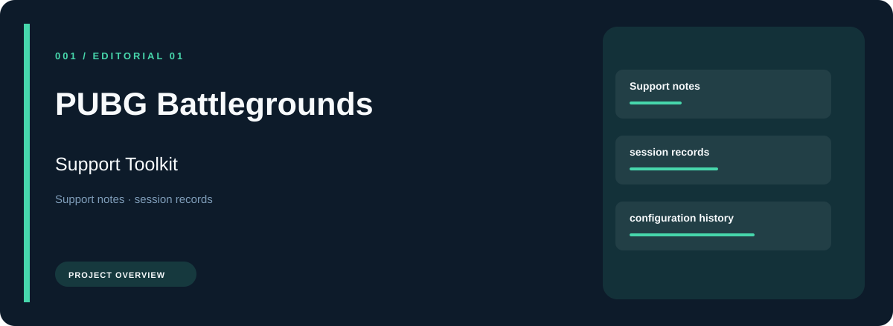
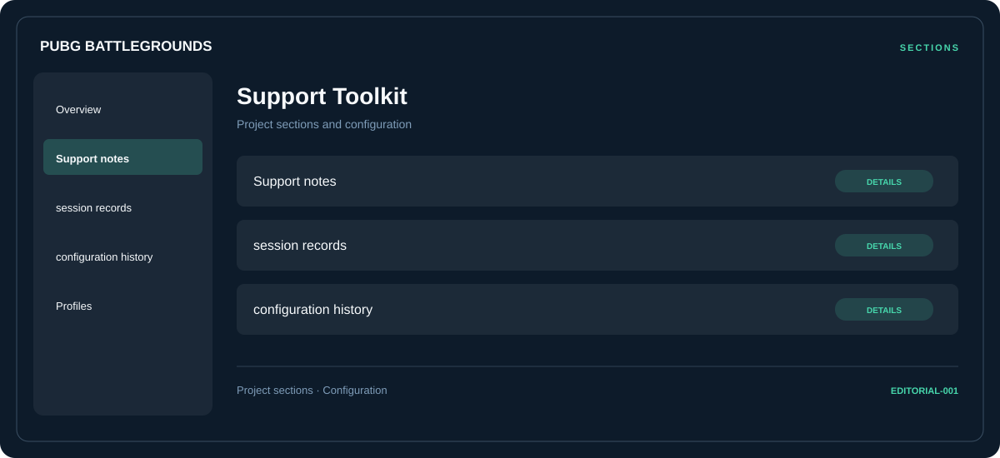

# 🎮 PUBG Battlegrounds Support Toolkit

**Support notes · Session records · Configuration history**

## ⚡ Features

PUBG Battlegrounds Support Toolkit groups support notes, session records, and configuration history in a single workspace. Each section keeps its controls and related settings together.

### ⚙️ Support notes

A dedicated section for support notes and the configuration details associated with that area.

### 🧩 Session records

Session and activity information grouped by the task or context it belongs to.

### ⌨️ Configuration history

A dedicated section for configuration history and the configuration details associated with that area.

## 🖥️ Project navigation

## 📥 Download

The button and cover open the project's download page. Use the information supplied with the downloaded package for installation and release-specific requirements.

## 📚 Project documentation

- [Feature reference](docs/FEATURES.md)
- [Download information](docs/DOWNLOAD.md)
- [Project page](index.html)

---

PUBG Battlegrounds Support Toolkit · Program documentation and download information.
